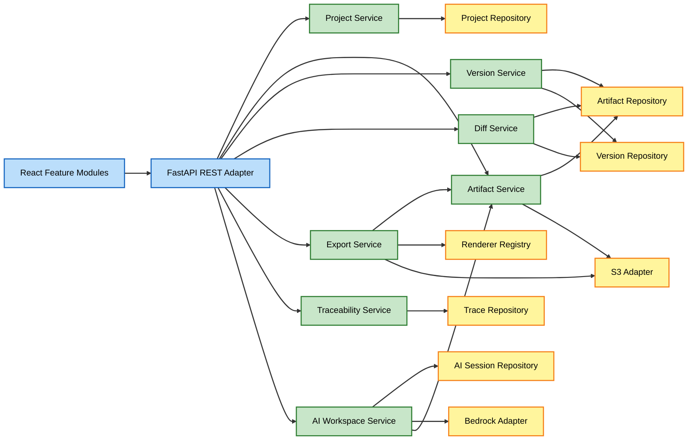

# Component Dependency and Communication Design

## Dependency Rules
1. React feature modules communicate only with the FastAPI REST Adapter through the shared API client.
2. REST Adapter invokes application services; it never accesses DynamoDB, S3, renderers, or Bedrock directly.
3. Application services depend on repository and external-service ports, not concrete AWS SDK calls.
4. Renderer implementations are selected through Renderer Registry and do not own Draft/version persistence.
5. AI Workspace Service owns temporary session state and can call Artifact Service only after explicit review-save.

## Component Dependency Diagram

### Text Alternative
- React feature modules call only the FastAPI REST adapter.
- The REST adapter delegates to project, artifact, version, diff, export, traceability, and AI workspace services.
- Services use repository ports for purpose-specific DynamoDB tables.
- Artifact/Export services use S3 for attachments and large bodies; Export Service selects document renderers.
- AI Workspace Service uses its TTL session repository and Bedrock Adapter. It invokes Artifact Service only after explicit save.

## Dependency Matrix
| Consumer | Provider | Communication | Reason |
|---|---|---|---|
| React Feature Modules | FastAPI REST Adapter | HTTPS REST/JSON | UI state and commands |
| FastAPI REST Adapter | Application Services | in-process typed calls | HTTP-to-application translation |
| Artifact Service | Artifact Repository | repository interface | Draft and metadata persistence |
| Version Service | Artifact/Version Repositories | repository interfaces | Draft reads and immutable snapshots |
| Diff Service | Artifact/Version Repositories | repository interfaces | Content comparison sources |
| Attachment/Export flow | S3 Adapter | object-storage interface | images and overflow content |
| Export Service | Renderer Registry | strategy interface | XLSX/DOCX renderer selection |
| Traceability Service | Trace Repository | repository interface | link and gap persistence |
| AI Workspace Service | AI Session Repository | repository interface | TTL temporary state |
| AI Workspace Service | Bedrock Adapter | generation port | conversational preview generation |
| AI Workspace Service | Artifact Service | in-process typed call | explicit reviewed Draft save |

## Data Ownership
| Data | Owner | Primary Store | Notes |
|---|---|---|---|
| Project metadata | Project Service | `projects` | Top-level context |
| Document metadata and current Draft | Artifact Service | `artifacts` with optional S3 body reference | One current Draft per document |
| Immutable version snapshots | Version Service | `artifact_versions` with optional S3 body reference | Never changed after confirmation |
| Image metadata | Attachment Service | `attachments` | Image bytes remain in S3 |
| Trace links | Traceability Service | `trace_links` | Story-requirement-test relations |
| AI messages and preview | AI Workspace Service | `ai_workspace_sessions` TTL | Not a document or version |

## Primary Data Flows
### Version Confirmation
React Version Feature → REST Adapter → Version Service → Artifact Repository + Version Repository → REST Adapter → React Version Feature.

### Export
React Artifact Feature → REST Adapter → Export Service → Artifact Service + Renderer Registry + S3 Adapter → REST Adapter → React Artifact Feature.

### AI Preview to Reviewed Draft
React AI Workspace Feature → REST Adapter → AI Workspace Service → AI Session Repository + Bedrock Adapter. After explicit save: AI Workspace Service → Artifact Service → Artifact Repository.
