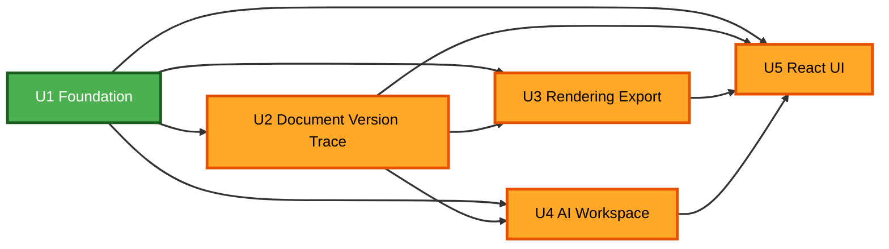

# Unit of Work Dependency

## Delivery Rule
One team implements units in strict sequence. A dependent unit does not begin implementation until its prerequisite unit has passed its design/code/test approval gate.

## Dependency Diagram

### Text Alternative
- U1 is the shared foundation and is required by U2, U3, U4, and U5.
- U2 is required by U3 for normalized artifact sources and by U4 for explicit reviewed Draft save.
- U3 and U4 both provide backend contracts that U5 consumes.
- Although U3 and U4 do not depend on each other, the agreed single-team sequence executes U3 before U4.
- U5 begins after U1 through U4 have completed.

## Dependency Matrix
| Consumer Unit | Provider Unit | Required Contract | Reason | Sequence Constraint |
|---|---|---|---|---|
| U2 | U1 | Domain types, repository interfaces, DynamoDB/S3 ports, revision primitives | U2 owns lifecycle workflows using shared persistence contracts | U1 before U2 |
| U3 | U1 | Artifact/attachment types, S3 port | Renderers require normalized artifact and object contracts | U1 before U3 |
| U3 | U2 | Artifact Draft/version read models | Exports and previews use artifact sources without owning lifecycle | U2 before U3 |
| U4 | U1 | AI-session type, TTL repository interface, Bedrock port | Temporary session implementation needs common contracts | U1 before U4 |
| U4 | U2 | `ArtifactService.save_reviewed_preview` interface | Explicit review-save creates an ordinary requirements Draft | U2 before U4 |
| U5 | U1 | Shared project/document/version API model types | UI client and context use stable contracts | U1 before U5 |
| U5 | U2 | Project, artifact, Draft, version, diff, trace REST resources | Core authoring and lifecycle UI | U2 before U5 |
| U5 | U3 | Preview, attachment, XLSX/DOCX export REST resources | Authoring and export UI | U3 before U5 |
| U5 | U4 | AI session/message/preview/save REST resources | AI workspace UI | U4 before U5 |

## Communication Constraints
1. Units communicate through typed domain/application interfaces and REST/OpenAPI contracts, never direct access to another unit's DynamoDB table.
2. U3 calls U2 read models/services only; it never writes Draft, version, or trace data.
3. U4 calls U2 only during explicit reviewed-preview save; normal messages update only its own TTL session state.
4. U5 calls FastAPI REST resources only; no React feature accesses AWS adapters directly.
5. Changes to a provider contract require updating its contract tests before a downstream unit begins or changes.

## Sequential Quality Checkpoints
| Before Starting | Required Evidence |
|---|---|
| U2 | U1 domain/repository contracts, persistence port tests, and approved interfaces |
| U3 | U2 artifact read models and Draft/version source contract tests |
| U4 | U2 reviewed-Draft save contract and U1 TTL session contract |
| U5 | Stable OpenAPI contracts for U2, U3, and U4 plus integration fixtures |

## Risk and Change Rules
- Shared type or repository changes begin in U1 and require downstream compatibility checks.
- Version/Draft lifecycle changes are U2-owned and must not be duplicated in U3, U4, or U5.
- AI preview remains temporary even if U4 changes; moving it to normal Draft persistence is a scope change requiring design review.
- Renderer additions are U3-owned; adding PPT later is a new U3 renderer strategy, not a new persistence or versioning lifecycle.
