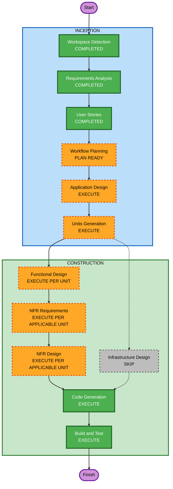

# Execution Plan

## Plan Status
- **Status**: Approved
- **Project Type**: Greenfield
- **Next Stage if Approved**: Application Design
- **Planning Depth**: Comprehensive

## Detailed Analysis Summary

### Scope and Impact
- **User-facing impact**: High. The React application introduces end-to-end workflows for project context, document authoring, Draft/version lifecycle, diff, exports, traceability, and AI-assisted requirements authoring.
- **Structural impact**: High. A new React frontend, FastAPI backend, domain model, DynamoDB persistence, S3 image storage, Bedrock adapter, rendering services, and test suites are required.
- **Data model impact**: High. Project, document, Draft, immutable version snapshot, attachment, trace link, and transient AI-workspace models are required.
- **API impact**: High. The frontend requires APIs for project context, documents, Draft edits, version confirmation/diff, exports, attachments, traceability, and AI conversations.
- **NFR impact**: High. DynamoDB size/conditional-write constraints, S3 references, Bedrock failure handling, immutable version integrity, and Hypothesis-based PBT require explicit design.

### Risk Assessment
- **Risk Level**: High
- **Rollback Complexity**: Moderate — the project is greenfield, but version persistence errors can corrupt user trust or lose work if not designed carefully.
- **Testing Complexity**: Complex — combines UI/API interactions, DynamoDB/S3 boundaries, document rendering, transient AI results, and serialization/invariant properties.
- **Risk Controls**: Immutable snapshots, conditional writes, explicit save/confirm screens, failure-preserving Draft behavior, example tests plus required PBT, and integration tests.

## Workflow Visualization

### Text Alternative
1. Completed: Workspace Detection, Requirements Analysis, User Stories.
2. Current approval gate: Workflow Planning.
3. Execute next: Application Design, then Units Generation.
4. Per generated unit: Functional Design, NFR Requirements, NFR Design when applicable, then Code Generation.
5. Skip: Infrastructure Design for this MVP.
6. Complete all units, then run Build and Test.

## Phase Decisions

### Completed Inception Stages
- [x] Workspace Detection — Greenfield workspace confirmed.
- [x] Requirements Analysis — Comprehensive requirements approved.
- [x] User Stories — P-ADMIN, five epics, and twelve BDD stories approved.
- [ ] Workflow Planning — Plan created; awaiting this approval.

### Inception Stages to Execute
- [x] **Application Design — EXECUTE (Comprehensive)**
  - **Rationale**: The product requires new UI, API, domain, persistence, rendering, attachment, traceability, and Bedrock integration components with clear dependencies and business rules.
  - **Deliverables**: Application architecture, component responsibilities, component methods, service boundaries, and a validated component diagram.
- [ ] **Units Generation — EXECUTE (Comprehensive)**
  - **Rationale**: The design spans multiple independently testable work units and must be sequenced around shared domain contracts.
  - **Expected decomposition candidates**: domain/persistence foundation; document/version APIs; rendering/export; Bedrock AI workspace; React UI and integration. Final unit boundaries are decided during this stage.

### Construction Stages to Execute
- [ ] **Functional Design — EXECUTE per applicable unit**
  - **Rationale**: Draft/version state, snapshot integrity, diff, artifact schemas, trace links, and AI save behavior have nontrivial rules. A presentation-only unit may be marked N/A after unit assessment.
- [ ] **NFR Requirements — EXECUTE per applicable unit**
  - **Rationale**: NFR-001 through NFR-006 require UX clarity, integrity, storage constraints, AI safety, maintainability, and PBT framework decisions.
- [ ] **NFR Design — EXECUTE per applicable unit**
  - **Rationale**: Required after NFR assessment to turn DynamoDB/S3/Bedrock/PBT decisions into concrete patterns.
- [ ] **Code Generation — EXECUTE per unit**
  - **Rationale**: Mandatory AIDLC phase for implementation, unit tests, and approved code-generation plans.
- [ ] **Build and Test — EXECUTE**
  - **Rationale**: Mandatory final verification, including unit, integration, rendering/export, and PBT execution instructions.

### Construction Stages to Skip
- [ ] **Infrastructure Design — SKIP for MVP**
  - **Rationale**: The product initially runs locally on EC2; deployment architecture, infrastructure-as-code, and production operations were explicitly deferred. This does not remove application-level DynamoDB/S3/Bedrock integration design.
  - **Reconsider when**: deployment automation, multi-environment hosting, IAM policy design, VPC/networking, production scaling, or operations requirements enter scope.

### Operations
- [ ] **Operations — PLACEHOLDER**
  - **Rationale**: The AIDLC Operations phase is not yet implemented. Deployment and monitoring are outside the current MVP scope.

## Recommended Unit Dependency and Sequence
This is a proposed order for Units Generation to validate and refine, not a finalized unit design.

1. **Shared domain and persistence foundation** — project/document/Draft/version/attachment/trace models and repository contracts. This is the dependency base.
2. **Document and version application services** — document CRUD, Draft lifecycle, confirmation, immutable snapshots, change history, and diff APIs.
3. **Rendering and export services** — Markdown rendering, Excel fixed templates, DOCX export, and attachment resolution. Depends on the domain model.
4. **AI workspace service** — project-scoped multi-turn Bedrock workflow, transient preview, error preservation, and reviewed Draft save. Depends on document services.
5. **React user interface** — project context, authoring, version/diff, exports, traceability, and AI workspace views. Integrates the completed backend contracts.

## Stage-Level Quality Gates
- **Application Design**: every requirement and story maps to components/services; component boundaries cover all integrations.
- **Units Generation**: each unit has dependencies, scope, and story mapping with no uncovered requirement.
- **Functional Design**: state transitions, data schemas, error paths, and testable business rules are explicit.
- **NFR Requirements/Design**: Hypothesis is selected for Python PBT; required round-trip/invariant/generator/reproducibility patterns are planned for applicable code.
- **Code Generation**: each unit has approved generation plan, example tests, and required PBT.
- **Build and Test**: all units build and integration, export, AI-failure, and PBT paths are documented and runnable.

## Extension Compliance
| Extension | Status | Workflow Planning Assessment |
|---|---|---|
| Security Baseline | Disabled | User selected not to enable it; no rules enforced. |
| Resiliency Baseline | Disabled | User selected not to enable it; no rules enforced. |
| Property-Based Testing | Enabled — Partial | Compliant at planning level: the plan schedules NFR and Functional Design before Code Generation and explicitly carries PBT-02, PBT-03, PBT-07, PBT-08, and PBT-09 into applicable units. |

## Success Criteria
- Application architecture and work units cover all approved stories and requirements.
- The product delivers Markdown/Excel/DOCX outputs, Draft/snapshot/diff behavior, S3 attachments, traceability, and reviewed Bedrock AI workflows.
- No AI result becomes an official document or version before explicit review/save.
- Version snapshots remain immutable and diff remains reproducible from stored content.
- Required PBT and conventional test coverage are implemented before Build and Test completes.
